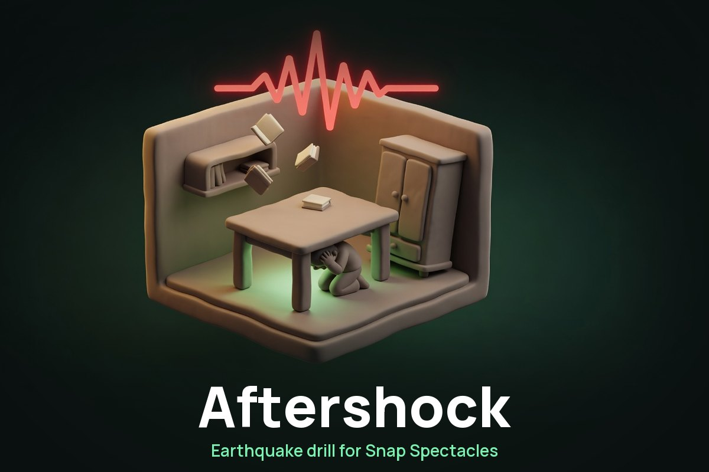
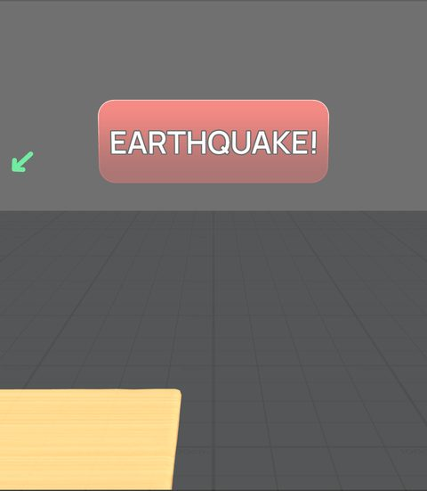
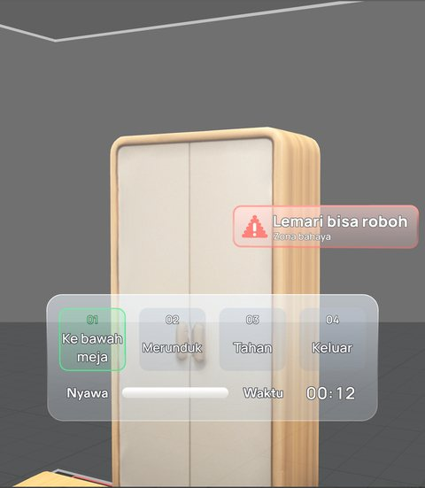
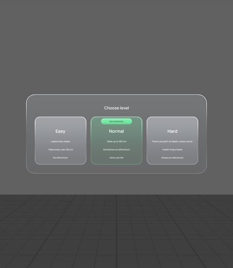
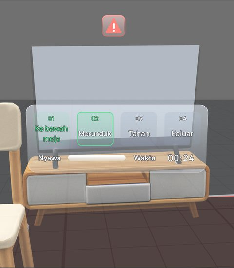
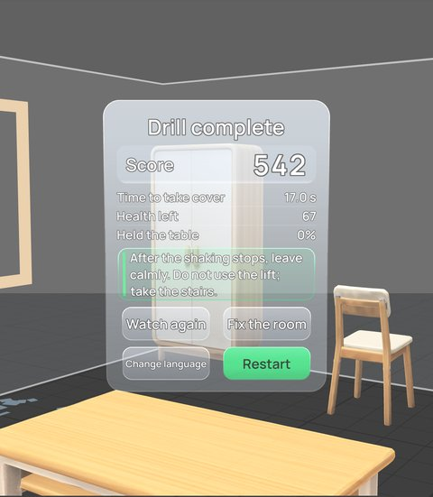
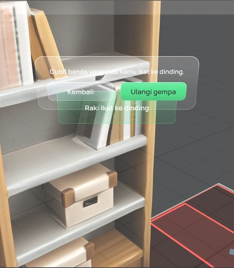
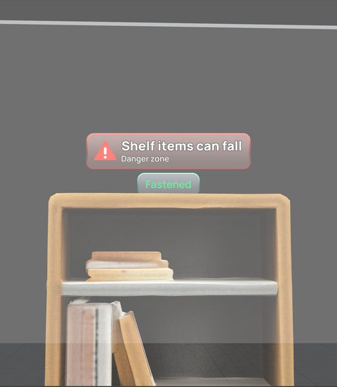
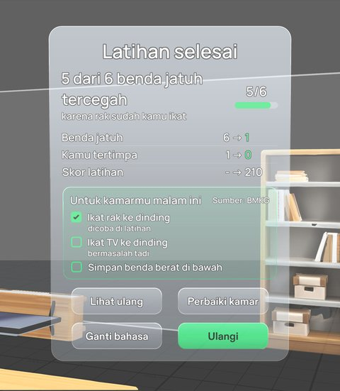

<p align="center"></p>

<h1 align="center">Aftershock</h1>

**An earthquake drill you walk through, for Snap Spectacles.** A virtual bedroom is built around you, every dangerous object is labelled, and then the shaking starts without warning. You have to get under a table, duck, hold on, and walk out — with your body, not with a button.

Built for the [Learn AR with SPECS](https://learn-specs.devpost.com) hackathon. It runs in the **Lens Studio preview**; no Spectacles device is needed.

[](https://ar.snap.com/lens-studio)
[](#tests)
[](#languages)

[What it does](#what-it-does) · [A drill, step by step](#a-drill-step-by-step) · [Gallery](#gallery) · [How it was built](#how-it-was-built) · [Tests](#tests) · [Run it yourself](#run-it-yourself) · [What's next](#whats-next) · [Credits](#credits)

## What it does

Reading a leaflet about earthquakes is easy to forget. Aftershock makes you *do* the drill: duck, cover, hold on, evacuate — in a room at real scale, with objects that fall on you if you stand in the wrong place.

- **A new room every drill.** 1–2 tables and 3–5 hazards (wardrobe, shelf, window, floor lamp, TV) are placed against the walls by a seeded generator, with a bed, a chair and a door. Nothing is hand-placed, so you cannot memorise one layout.
- **The quake comes without warning,** 8–15 s after the briefing, and lasts 45–60 s. On Normal there is a 50% chance of an aftershock.
- **Mistakes cost health.** Standing up after you have taken cover, staying in a red danger zone, letting go of the table leg, an item from the shelf landing on your head (−15), the window shattering next to you (−15), tripping over debris on the way out (−10).
- **A score out of 1000** in four parts: how fast you took cover (450, measured from when the quake starts, minus the walk to the nearest table), the health you kept (300), how long you held the table leg (100), and the evacuation (150). Never taking cover scores 0.
- **Then it teaches.** Up to two education cards, picked from what actually happened in your drill, each sourced from [BMKG](https://bmkg.go.id) — Indonesia's meteorology, climatology and geophysics agency.
- **Watch yourself again.** "Watch again" replays your own path on the floor: red where you were in a danger zone, green where you took cover, with markers where things landed.
- **Then fix the room.** "Fix the room" marks every object that caused a problem; pinch one to fasten it to the wall, then replay *the same quake* — same seed, same falls, same timing — and see the difference, for example "3 of 4 falling items prevented".

**Who it's for:** anyone who lives where the ground moves. Indonesia recorded 7,358 earthquakes in 2024, 743 of them felt (BMKG). The idea is that the reflex is what saves you, and a reflex has to be practised, not read.

## A drill, step by step

| | What you do | What the Lens does |
|---|---|---|
| 1 | Pick a language | Five buttons: Bahasa Indonesia, English, Deutsch, 日本語, 简体中文 |
| 2 | Read the safety notice, pinch Continue | "This is a drill, not a real earthquake alert" |
| 3 | Pick a level | Easy, Normal (recommended), Hard |
| 4 | Duck once to calibrate (or Skip) | Learns your duck line from your own head height |
| 5 | Look around the room | A scan sweep labels each hazard and marks the safe zone under each table |
| 6 | **The quake starts** | Banner, rumble, room shakes, HUD with 4 steps, health and timer |
| 7 | Walk under a table (WASD), duck (Q/E), hold the leg (pinch and hold) | Steps tick off one by one; a voice reads each instruction |
| 8 | Stay down until it stops | Standing up drains health; an arrow points back to cover if you turn away |
| 9 | Come out, walk to the door | Danger zones still drain; fallen items trip you |
| 10 | Read your score | Four parts, personal best per level, up to two BMKG cards |
| 11 | "Watch again" / "Fix the room" | Replay your path, or fasten objects and repeat the same quake |

**Levels.** Easy: labels stay visible through the quake, a table within 150 cm, no aftershock. Normal: tables up to 250 cm, 50% aftershock, items fall. Hard: find it yourself — no labels, no red zones, no arrow, no floor path — health drains 1.5× faster and there is always an aftershock. Hard reveals what was dangerous on the result screen.

## Gallery

Screenshots from the Lens Studio preview, with the Lens set to English.

| | |
|---|---|
| <br>The quake starts: the EARTHQUAKE! banner | <br>Under the table: the HUD ticks off the four steps |
| <br>Three levels, Normal recommended | <br>The TV topples off its stand (the stand stays) |
| <br>The result: score, the four parts, BMKG cards | <br>Fix the room: pinch the shelf to fasten it |
| <br>The same quake again, the shelf marked Fastened | <br>3 of 4 falling items prevented, and a checklist for your real room |

## How it was built

The Lens was built by an **AI coding agent** (Claude Code) running the **CLAD plugin** inside **Lens Studio 5.23.2**, through the **Lens Studio MCP**. The project was planned first with the Devpost Learn skill pack: the interview, the approved design brief (`devpost/design-brief.md`) and then six planning documents in `docs/`.

One honest exception: in the first days (up to 31 Oct) the orchestrator agent also made a few small fixes directly — mostly in test files and one-line corrections — when a build session had run out of budget. After that, every change to Lens code, tests included, went through a CLAD session.

The build ran as **16 slices**, one narrow task per capped headless agent session. An orchestrator agent wrote the plan and the prompt for each slice, then verified the result itself over the same MCP — running the LEAF suite, driving the preview, taking screenshots and reading them — before committing. The orchestrator also made the assets the build agent could not: the font subsets, the synthesized sound effects, the 60 TTS voice clips, and the split of the TV mesh in Slice 16. Design decisions were never the agents': each one was put to the learner, and the ones they did not answer are marked **(default)** in the plan, open to veto.

Full disclosure of who did what is in [`docs/ENGINEERING_PLAN.md`](docs/ENGINEERING_PLAN.md); the git history names the CLAD session behind each slice.

**Planning docs**

| File | What's in it |
|---|---|
| [`devpost/design-brief.md`](devpost/design-brief.md) | The approved brief from the skill pack interview — the top authority |
| [`docs/PRODUCT_REQUIREMENT_DOCUMENT.md`](docs/PRODUCT_REQUIREMENT_DOCUMENT.md) | R1–R33 user stories, done criteria, open questions |
| [`docs/TECHNICAL_DESIGN_DOCUMENT.md`](docs/TECHNICAL_DESIGN_DOCUMENT.md) | Architecture, state machine, every tunable, the score formula, the test plan |
| [`docs/USER_FLOW_DIAGRAM.md`](docs/USER_FLOW_DIAGRAM.md) | The flow as the user sees it |
| [`docs/DESIGN_BRIEF.md`](docs/DESIGN_BRIEF.md) | Colours for an additive display, type sizes, furniture in cm |
| [`docs/ENGINEERING_PLAN.md`](docs/ENGINEERING_PLAN.md) | Slices, dated decisions, status |
| [`docs/IMPLEMENTATION_RULES.md`](docs/IMPLEMENTATION_RULES.md) | What the build agent may and may not touch |
| [`docs/STRINGS_I18N.md`](docs/STRINGS_I18N.md) | Every string × 5 languages |
| [`docs/EDUCATION_CARDS.md`](docs/EDUCATION_CARDS.md) | The 7 education cards and their BMKG sources |
| [`docs/VOICE_CREDITS.md`](docs/VOICE_CREDITS.md) | Every TTS model, its licence and its Whisper check |

**Code** (`Assets/Scripts/Aftershock/`, ~14,700 lines)

| Module | Role |
|---|---|
| `DrillController.ts` | The state machine: LANGUAGE → SAFETY → LEVEL → CALIBRATE → BRIEFING → QUAKE → POST_QUAKE → (AFTERSHOCK) → EVACUATE → RESULT / GAME_OVER |
| `DrillPlan.ts` | One seeded plan per drill: quake wait and length, aftershock, every fall, the TV topple, the shards — so a repeat is identical |
| `LayoutGenerator.ts` | The room: wall-backed items facing in, walkways, distance bands, pairwise gaps, a fixed fallback |
| `DrillConfig.ts` | Every tunable in one place, each with a hint |
| `ScoreCalculator.ts` | The four score parts, pure and unit-tested |
| `HazardLabel.ts`, `DangerZone.ts`, `SafeZone.ts` | World labels that follow your distance, red floor zones, the marker under each table |
| `Hud.ts`, `ResultPanel.ts`, `UiBacking.ts` | The HUD, the result panel, and the glass material system (three tiers, no blur, no dark plate) |
| `ReplayTrack.ts`, `ReplayView.ts` | Records your path 10×/s and draws it back |
| `FixRoomView.ts` | Fix mode: pinch markers, the instruction panel |
| `PanelFollow.ts` | Panels lazily follow your head with a 25° / 50 cm dead zone |
| `QuakeShaker.ts`, `ShakeFx.ts`, `FallingObjects.ts` | The shake, the cracks and shards, the falling items |
| `VoiceGuide.ts`, `Strings.ts` | The voice clips and all five languages |

**3D models** were generated with CLAD's `build-mesh` (`Assets/GeneratedMeshes/`). The window is a primitive, because a generated one came with its own piece of wall.

## Tests

29 LEAF scenarios (`Assets/Scripts/Aftershock/Tests/`), **all passing**. They drive the drill through a head-pose override and SIK hand interactors, so they test the real code paths, not stubs.

```
dc1-safety-then-room        dc11-aftershock          dc21-change-language
dc2-quake-starts            dc12-levels              dc22-glass-break
dc3-arrow-and-take-cover    dc13-falling-objects     dc23-design-pass
dc4-stand-up-drains...      dc14-walls-and-door      dc24-hud-contrast
dc5-quake-ends-score        dc15-evacuation          dc25-ghost-replay
dc6-danger-zone-drains      dc16-hold-on             dc26-panel-follow
dc7-languages-and-restart   dc17-calibrate-and-best  dc27-repeat-quake
dc8-bed-trap                dc18-tv-topple           dc28-fix-room
dc9-two-tables              dc19-education-cards     dc29-stops-and-glass-trip
dc10-scan-path-edge         dc20-voice-guide
```

They check more than state: the exact score against the calculator, that the room generator obeys every rule over fixed seed lists, that a repeat quake is identical, that every text on the result panel and on the hazard labels is at least 90% opaque, that the HUD never draws a dark plate on an additive display, that the window label stays within 1 cm of its intended height while the room tilts, and that the TV's stand does not move when the TV topples.

To run them: enable the `LeafAutoRun` object in the scene, save, refresh the preview, and watch the log (about 35 minutes for all 29).

## Run it yourself

1. Lens Studio **5.23.2**, then open `Aftershock.esproj.esproj`.
2. Set the Preview panel to **Interactive**.
3. Press play. Controls: **WASD** to walk, **Q/E** to duck and stand, **right-drag** to look, **click** to pinch.
4. Pick a language, read the notice, pick **Normal**, and wait — the quake starts on its own.

For a repeatable take, set `layoutSeed` and `planSeed` on the `DrillConfig` component to any non-zero number (set them back to 0 before running the tests).

## Languages

Every screen is in the one language you pick: **Bahasa Indonesia, English, Deutsch, 日本語, 简体中文**, including the 60 voice clips. The German, Japanese and Chinese texts are machine translations, marked (default) in `docs/STRINGS_I18N.md` and not checked by a native speaker. Japanese and Chinese use bundled Noto Sans subsets, because Lens Studio's own fonts have no CJK glyphs.

## What's next

Not built, and not claimed to be built:

- **Your real room.** World Query hit testing and Spatial Anchors would let the Lens find your real furniture and remember a real safe spot — but neither works in the Lens Studio preview, so it could not be demonstrated for this hackathon. A spike (see the plan) showed hit testing only returns surfaces near the centre of view and never the floor or low furniture.
- **Marking objects yourself** by pinching at them (brief stretch goal S2).
- **On-device verification.** Everything here was built and checked in the preview; it has never run on Spectacles hardware.
- Decimated meshes for the device, and the "feel" of the drill checked by people other than the author.

## Credits

- **Fonts:** [Manrope](https://github.com/sharanda/manrope) and [Noto Sans JP / SC](https://github.com/notofonts) — SIL Open Font License 1.1, licences in `Assets/Aftershock/Fonts/`. Subset to the strings in use.
- **Sound effects** (rumble, thud, glass crack, shatter, chime, heartbeat): synthesized from code for this project with numpy; nothing sampled.
- **Voice:** 60 clips from open text-to-speech models (Pocket TTS Indonesian, Piper, Kokoro-82M), every model, licence and voice dataset listed in [`docs/VOICE_CREDITS.md`](docs/VOICE_CREDITS.md). No person was recorded.
- **3D models:** generated with CLAD `build-mesh` in Lens Studio.
- **Safety content:** [BMKG](https://bmkg.go.id) — "Antisipasi Gempa Bumi" and the BMKG/JICA "Siaga Gempabumi dan Tsunami" booklet, cited per card in [`docs/EDUCATION_CARDS.md`](docs/EDUCATION_CARDS.md).
- **Logo:** the diorama mark was generated with xai/grok-imagine-image; the wordmark is set in Manrope (OFL) by code.
- **Packages:** Spectacles Interaction Kit, Spectacles UI Kit, LEAF — bundled by Lens Studio under their own licences.
- **Licence:** the project's code and documents are released under the [MIT License](LICENSE). The fonts, voice clips and bundled packages listed above keep their own licences.
