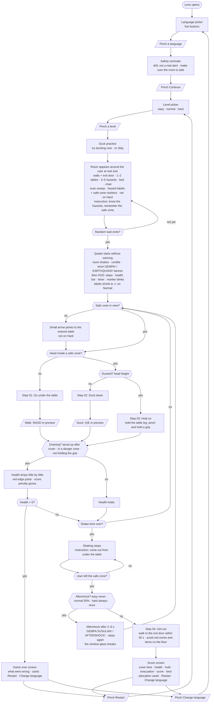
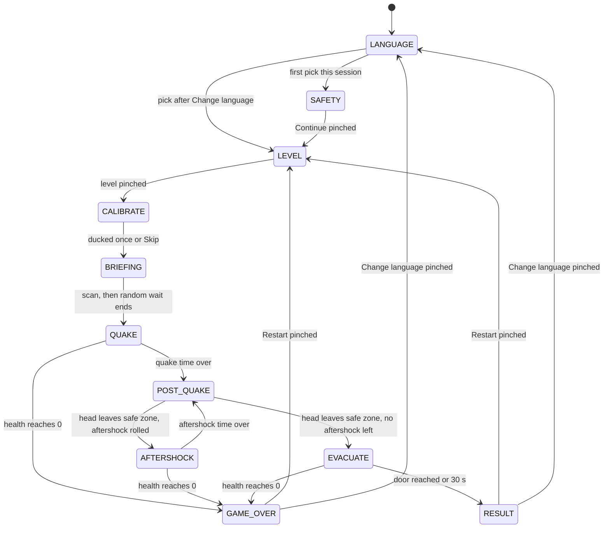

# User Flow Diagram: Aftershock

> Updated 31 Oct 2026 to match the build at 5b4958e (Slices 8-12B).

Built the way Adobe's guide describes (https://business.adobe.com/blog/basics/how-to-make-a-user-flow-diagram): one user goal, a clear entry point, every step and decision on the way, and the final action, drawn from the user's point of view.

- **User:** anyone (family at home, a school student, an office worker) practicing an earthquake drill.
- **Goal:** take cover under a table, duck, and hold on until the shaking stops, then get out through the door.
- **Entry point:** the Lens opens.
- **Success:** the score screen after the evacuation (door reached, or the 30 s limit). **Failure:** the game-over screen. Restart opens the level picker (5j-19a); Change language opens the language picker, then the level picker (Slice 10B). The safety reminder shows once per session.

Legend: rounded box = what the user sees, diamond = a check the Lens makes, parallelogram = what the user does.

> States: `LANGUAGE → SAFETY → LEVEL → CALIBRATE → BRIEFING (scan) → QUAKE → POST_QUAKE → [AFTERSHOCK → POST_QUAKE] → EVACUATE → RESULT` or `GAME_OVER`; Restart → `LEVEL`; Change language → `LANGUAGE → LEVEL`. Restart keeps the language and preselects the level.

## 1. Main flow

Falls happen inside the quake and aftershock loop (not on Easy): books and boxes from the shelf, and the TV topples once per drill; a hit costs health only inside the hazard's danger zone and not under a table. After Change language, the language pick goes straight to the level picker (no safety reminder). Health 0 in the aftershock or the evacuation also leads to the game-over screen.

## 2. States (for the build)

## 3. What is visible in each step

| Step | Visible | Hidden |
|---|---|---|
| Language picker | Five language buttons, title in all five languages | Room, HUD, results |
| Safety reminder | Reminder panel, Continue | Room labels, HUD, arrow, results |
| Level picker | Three level cards (current preselected) | Room labels, HUD, results |
| Duck practice | "Try ducking now", Skip, then "Good, that's how" | Room, HUD, results |
| Briefing | Room with walls and door, scan sweep, hazard labels, safe-zone markers (steady), faint floor path, briefing instruction (Hard: room only) | HUD, arrow, results |
| Quake / aftershock | Shaking room, warning banner (first 1.2 s), then HUD (steps, health bar, timer; notices in the step row), blinking markers, labels as ⚠ (Normal) or full (Easy), floor path and arrow (only when the zone is out of view), red edge pulse while draining, falling items, cracks | Reminder, results; on Hard every guide |
| After the quake | Room at rest, steady markers, "come out" instruction | Banner, arrow |
| Evacuation | Step 04, exit door label, arrow and floor path to the door (not on Hard), fallen items and shards on the floor | Banner |
| Score / game over | Result panel (score parts, best, cards), Restart, Change language; on Hard the reveal of safe and dangerous items | HUD, arrow |

## 4. Friction points to watch in testing

1. **The safe zone behind the user.** The arrow is the only cue. Check that it appears and reads in under a second.
2. **Knowing what to do after the shaking.** The "come out" instruction (PRD Q2), then step 04 and the path to the door.
3. **Standing up by accident.** Hysteresis on the duck check (TDD §5) stops flicker between "duck" and "hold".
4. **Restart target.** The level picker with the current level preselected, one pinch to keep it (5j-19a; was straight to the room, PRD Q1).
5. **Doing nothing.** Because the stand-up drain starts only after taking cover once (PRD Q5), a user who never takes cover loses no health from it (danger zones, falls and glass still can). The result screen says so and the score is 0, evacuation included (PRD Q6, learner 5l-4b).
