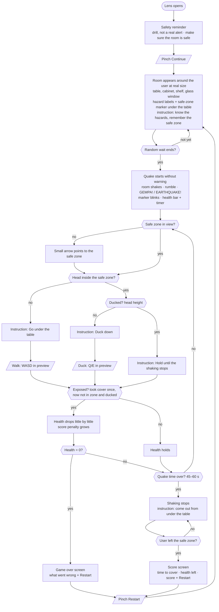
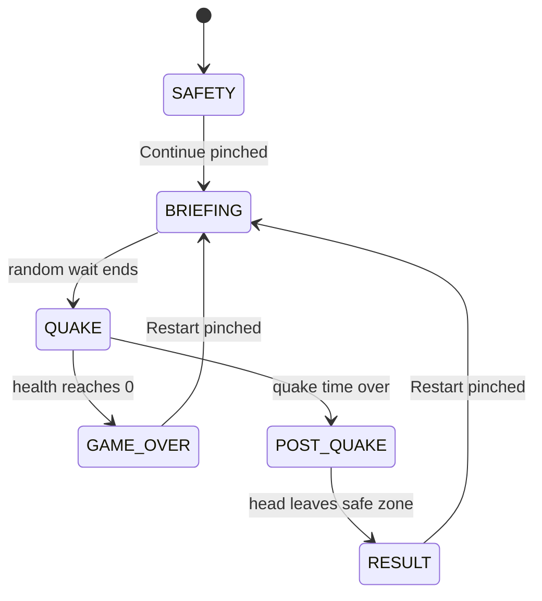

# User Flow Diagram: Aftershock

Built the way Adobe's guide describes (https://business.adobe.com/blog/basics/how-to-make-a-user-flow-diagram): one user goal, a clear entry point, every step and decision on the way, and the final action, drawn from the user's point of view.

- **User:** anyone (family at home, a school student, an office worker) practicing an earthquake drill.
- **Goal:** take cover under the table, duck, and hold on until the shaking stops.
- **Entry point:** the Lens opens.
- **Success:** the score screen after leaving the safe zone. **Failure:** the game-over screen. Both lead back to the room through Restart (Q1). The safety reminder shows only when the Lens opens.

Legend: rounded box = what the user sees, diamond = a check the Lens makes, parallelogram = what the user does.

## 1. Main flow

## 2. States (for the build)

## 3. What is visible in each step

| Step | Visible | Hidden |
|---|---|---|
| Safety reminder | Reminder panel, Continue | Room labels, HUD, arrow, results |
| Briefing | Room, hazard labels, safe-zone marker (steady), briefing instruction | HUD, arrow, results |
| Quake | Shaking room, labels, blinking marker, warning banner (first seconds), instruction, health bar, timer, arrow (only when the zone is out of view) | Reminder, results |
| After the quake | Room at rest, steady marker, "come out" instruction | Banner, arrow |
| Score / game over | Result panel with Restart | HUD, arrow |

## 4. Friction points to watch in testing

1. **The safe zone behind the user.** The arrow is the only cue. Check that it appears and reads in under a second.
2. **Knowing that leaving the zone shows the score.** The "come out" instruction covers it (PRD Q2).
3. **Standing up by accident.** Hysteresis on the duck check (TDD §5) stops flicker between "duck" and "hold".
4. **Restart target.** Straight back to the room (PRD Q1, learner).
5. **Doing nothing.** Because health drains only after taking cover once (PRD Q5), a user who never takes cover loses no health. The result screen says so and the score is 0 (PRD Q6, default).
